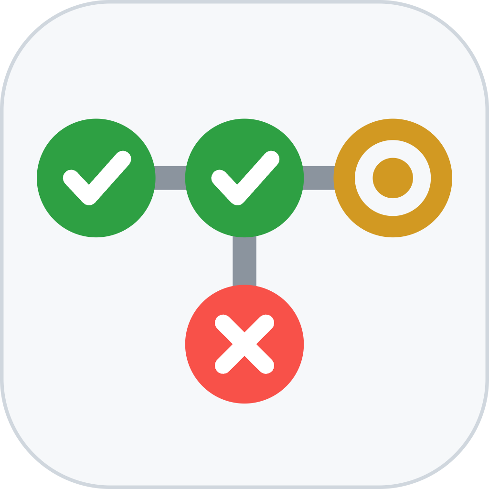

<p align="center"></p>

<h1 align="center">Actions Lights</h1>

<p align="center">
  Tus workflows de GitHub Actions como un semáforo en la barra de menús o la bandeja del sistema.
  <br>
  <a href="README.md">Read in English</a>
</p>

<p align="center">
  <a href="https://github.com/luyz2000/actions-lights/releases/latest"></a>
  <a href="https://github.com/luyz2000/actions-lights/actions/workflows/ci.yml"></a>
  <a href="LICENSE"></a>
  
  <a href="https://github.com/luyz2000/actions-lights/releases"></a>
</p>

Mergeas a tu rama de release, sigues trabajando y le echas un vistazo a la barra: rojo si algo falló, amarillo mientras corre, verde cuando terminó.

## Funciones

- **Semáforo en la barra:** rojo si algo falló, amarillo mientras corre (con anillo de progreso) y verde cuando todo terminó. Si no pasa nada, muestra el icono de la app y «Todo en orden».
- **Texto corto junto al semáforo** (macOS): el workflow en curso, su paso actual y el tiempo transcurrido.
- **Panel al hacer clic:** workflows agrupados por repo, con el paso en curso, el progreso frente a la duración habitual, el paso donde falló, el título del PR o commit, quién lo lanzó, la rama y el evento. Un clic abre el run en GitHub.
- **Cuenta detectada sola:** tu sesión de GitHub CLI (`gh`) o un token personal guardado en el llavero del sistema.
- **Actualizaciones desde la app:** busca nuevas versiones en GitHub Releases cada 6 horas; un clic instala y reinicia.
- **Seis idiomas:** inglés, español, ruso, francés, japonés y chino. Sigue el idioma del sistema, o puedes elegir uno en **Configuración → General**.
- **macOS, Linux y Windows.**
- **Notificaciones (próximamente):** en pausa hasta que la app de macOS esté firmada por Apple.

## Instalación

Descarga el archivo para tu sistema del [último release](https://github.com/luyz2000/actions-lights/releases/latest).

| Sistema | Archivo | Notas |
|---|---|---|
| macOS (Apple Silicon e Intel) | `Actions-Lights_X.Y.Z_universal.dmg` | Arrastra la app a **Aplicaciones**. |
| Debian / Ubuntu (x86_64) | `Actions.Lights_X.Y.Z_amd64.deb` | `sudo apt install ./Actions.Lights_X.Y.Z_amd64.deb` |
| Otras distribuciones Linux (x86_64) | `Actions.Lights_X.Y.Z_amd64.AppImage` | Dale permiso con `chmod +x` y ábrelo. |
| Windows (x86_64) | `Actions.Lights_X.Y.Z_x64-setup.exe` | Se instala para tu usuario, sin permisos de administrador. |

Después activa los workflows que quieres vigilar en **Configuración → Repos y workflows**. Normalmente, el deploy de tu rama de release.

## Conectar tu cuenta de GitHub

La app usa la primera cuenta que encuentra:

1. **GitHub CLI:** si hiciste `gh auth login` en este equipo, no hay nada que configurar.
2. **Token personal:** pégalo en **Configuración → Cuenta**. Usa un token clásico con el permiso `repo`, o uno fine-grained con **Actions: read** (y **Metadata: read**) en los repos que quieres vigilar.

Sin cuenta, la app puede vigilar repos públicos y se actualiza cada 5 minutos.

## Cómo funciona

- **Consultas:** cada 15 s si algo está corriendo, cada 60 s en reposo y cada 5 min sin cuenta. Se espacia sola si el límite de la API baja. Usa peticiones condicionales (ETags), así que las respuestas sin cambios no gastan límite.
- **Sin conexión:** si no puede llegar a GitHub (el Wi-Fi está volviendo, acabas de iniciar sesión), reintenta a los 5, 10, 20 y 40 segundos y después vuelve al ritmo normal.
- **Progreso:** se estima con los pasos del job y la duración mediana de las últimas ejecuciones correctas.
- **Almacenamiento:** el token se guarda en el llavero del sistema (Llavero de macOS, Administrador de credenciales de Windows o Secret Service en Linux). La configuración es un archivo JSON en la carpeta de configuración de la app.

## Privacidad

- Sin telemetría, analíticas ni cuentas propias.
- La app solo habla con `api.github.com` (tus workflows) y con los GitHub Releases de este repo (actualizaciones).
- Tu token no sale de tu equipo salvo en las peticiones a GitHub.

## Problemas comunes

<details>
<summary><b>macOS dice que la app no se puede abrir o que «está dañada»</b></summary>

La app todavía no está firmada con un certificado de Apple Developer. Ábrela una vez con **clic derecho → Abrir**, o ejecuta:

```sh
xattr -cr "/Applications/Actions Lights.app"
```
</details>

<details>
<summary><b>SmartScreen de Windows bloquea el instalador</b></summary>

El instalador todavía no está firmado. Pulsa **Más información → Ejecutar de todas formas**. Una vez instalada, el semáforo vive en la bandeja; puede estar escondido tras la flecha **^** de la barra de tareas.
</details>

<details>
<summary><b>No aparece el icono en la bandeja en Linux (GNOME)</b></summary>

GNOME oculta los iconos de la bandeja por defecto. Instala la extensión **AppIndicator and KStatusNotifierItem Support**. En Linux el panel se abre desde el menú del icono (**Ver estado**).
</details>

<details>
<summary><b>Se queda en «Sin conexión con GitHub»</b></summary>

La app reintenta sola a los pocos segundos de que vuelva la red. Si sigue igual, revisa tu conexión o proxy y usa **Actualizar ahora** en el menú del icono.
</details>

<details>
<summary><b>«Token inválido o caducado»</b></summary>

Vuelve a ejecutar `gh auth login`, o cambia el token en **Configuración → Cuenta**. En organizaciones con SSO, el aviso enlaza a la página donde autorizas el token.
</details>

<details>
<summary><b>Un workflow muestra «No encontrado»</b></summary>

El token no ve ese repo: es privado y el token no tiene acceso, o el repo cambió de nombre. Revisa los permisos del token o su acceso a repositorios.
</details>

## Contribuir

Las contribuciones son bienvenidas mediante **pull requests**. El mantenedor revisa y fusiona cada PR; nada se fusiona de forma automática. Para cambios grandes, abre antes un issue para comentar la idea.

Para añadir o corregir una traducción, edita los archivos de [`src/lib/i18n/`](src/lib/i18n/). Cada idioma debe tener las mismas claves y `{marcadores}` que `en.json`; los tests lo comprueban.

## Licencia

[MIT](LICENSE) © 2026 luyz2000
